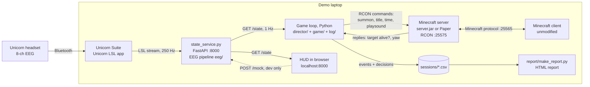
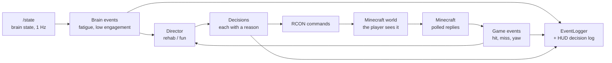

# Architecture

How the BrainCraft applications communicate and how the game loop works.
GitHub renders the Mermaid diagrams below.

## How the applications talk
Everything runs on **one demo laptop** (Windows, because of Unicorn Suite). During development, everyone else runs `state_service.py` in **mock mode**, with HUD sliders instead of the headset.

| Link | Protocol | Port |
|---|---|---|
| Headset → Unicorn Suite | Bluetooth | — |
| Unicorn Suite → state service | LSL | network multicast (same machine is safest) |
| State service → game loop, HUD | HTTP `GET /state` | 8000 |
| Game loop ↔ Minecraft server | RCON (TCP), plain command text | 25575 |
| Minecraft server ↔ client | normal multiplayer, join `localhost` | 25565 |

## The game loop
Minecraft only shows the world and takes the player's input. The Python game loop (~5 Hz) makes every decision and changes the world only through RCON commands.

- **Game event:** poll `execute if entity @e[tag=t17]`. The target is gone before 6 s → hit (feedback sound, staircase update). Still there → miss (smoke, kill, maybe cues on).
- **Brain event:** e.g. `fatigue_z > 1.5` for 20 s with good quality → rest phase shown as dawn (`time set 23000`, "Take a breath"), then back to midnight with slower spawns.
- Every decision is mirrored in-game (`title @p actionbar …`) and in the HUD log, so judges see why the game changed.
