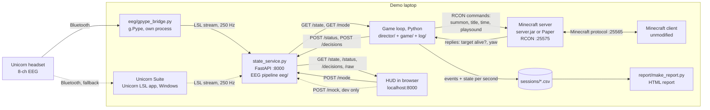
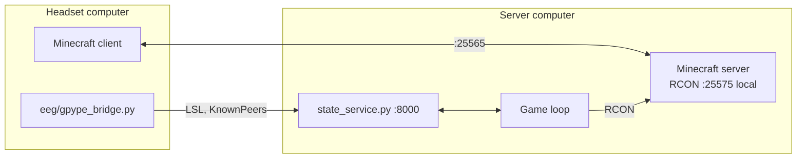
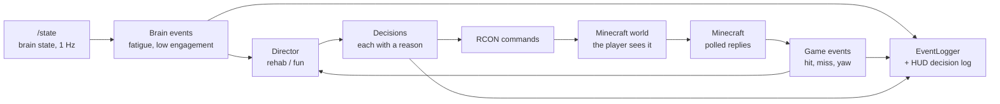

# Architecture

How the BrainCraft applications communicate and how the game loop works.
GitHub renders the Mermaid diagrams below.

## How the applications talk
Everything runs on **one demo laptop** (Windows x64, an Apple-silicon Mac or Linux x86-64 with the g.Pype bridge; Windows if we fall back to Unicorn Suite). During development, everyone else runs `state_service.py` in **mock mode**, with HUD sliders instead of the headset.

**Stand-ins without the hardware** (same interfaces, so only the source changes):

| Missing | Stand-in | How |
|---|---|---|
| Headset | synthetic EEG | `python -m eeg.synthetic --lsl` (controllable from stdin) or `BRAINCRAFT_EEG_INPUT=synthetic` |
| Any EEG | mock brain state | state service in mock mode, HUD sliders |
| Minecraft | `mc/sim.py` `SimRcon` | `game_loop.py --sim`: a seeded player with a left-neglect profile |

**Two computers (optional):** to spread the load, the headset computer runs only the bridge and the Minecraft client, and the server computer runs the Minecraft server, state service, HUD and game loop. Only two links cross the network: LSL (bridge → state service, found by unicast through liblsl `KnownPeers`, ports 16571–16604) and the Minecraft protocol (client → server, 25565). RCON stays local to the server computer. Setup: [setup.md, "Two computers"](setup.md#two-computers).

**Why the headset reader is a separate process:** the state service only reads the LSL stream (its `eeg/` pipeline runs in a background thread). The reader runs on its own, so:
- after a Bluetooth drop, only the reader restarts, while the HUD, game loop and Minecraft session keep running;
- on macOS, g.Pype needs the main thread's event loop, which uvicorn already owns in the state service;
- LSL allows several readers at once: `eeg.check`, LabRecorder or a viewer can watch the same stream during a game, and the fallback reader (Unicorn LSL app or `eeg.synthetic --lsl`) needs no code change.

See [setup.md](setup.md) for how to run every piece.

| Link | Protocol | Port |
|---|---|---|
| Headset → reader (g.Pype bridge, or Unicorn Suite) | Bluetooth | — |
| Reader → state service | LSL, stream `BrainCraft-Unicorn`, type `EEG` | network multicast (same machine is safest) |
| State service ↔ game loop, HUD | HTTP: `/state`, `/status`, `/decisions`, `/mode`; `/raw` (EEG scope) | 8000 |
| Game loop ↔ Minecraft server | RCON (TCP), plain command text | 25575 |
| Minecraft server ↔ client | normal multiplayer, join `localhost` | 25565 |

## The game loop
Minecraft only shows the world and takes the player's input. The Python game loop (~5 Hz) makes every decision and changes the world only through RCON commands.

- **Game event:** poll `execute if entity @e[tag=t17]`. The target is gone before its 60 s are up → hit (feedback sound, staircase update, next target in 1 s). Still there → miss (smoke, kill, maybe cues on).
- **Brain events (rehab):**
  - `fatigue_z > 1.5` for 20 s with good quality → rest phase shown as dawn (`time set 23000`, "Take a breath"), then back to midnight with slower spawns.
  - ALI (vs the player's calibration) below −0.05 for 10 s → "rightward bias": `p_left` +0.3. Back above 0 for 10 s → off. Each switch holds at least 20 s.
- **Player:** the movement lock and food are re-applied every 5 s, because a death and respawn resets them (skeletons shoot back; difficulty normal).
- Every decision is mirrored in-game (`title @p actionbar …`) and in the HUD log, so judges see why the game changed.
