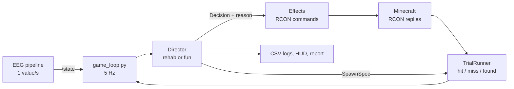
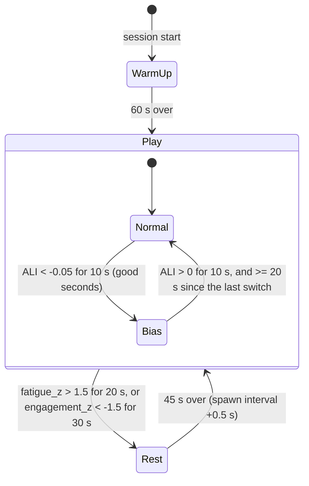
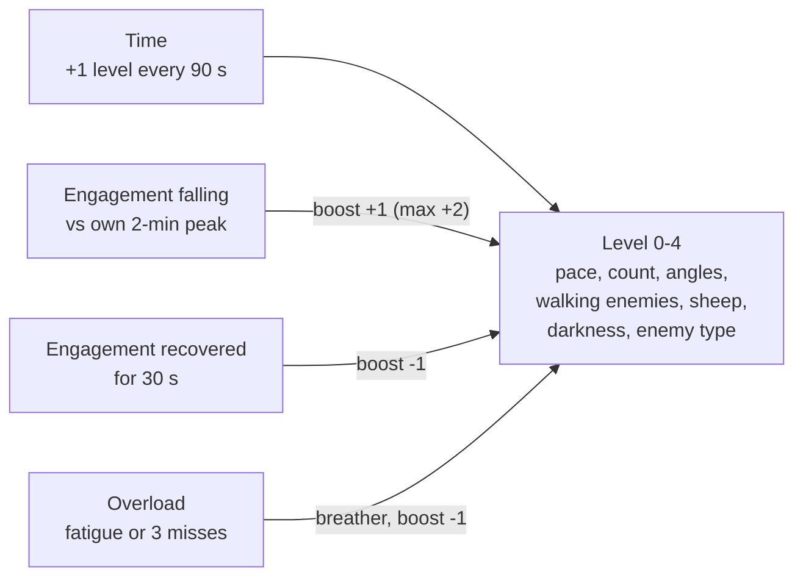

# Game modes: how they work

How BrainCraft decides **what appears, where, when, and why**. There are
two modes: **rehab** (default) and **fun**. You can switch between them
live with the HUD buttons. Parameters live in `director/rehab.py`
(`RehabParams`), `director/fun.py` (`FunParams`, `LEVELS`) and
`mc/config.py`.

## Contents
- [Shared machinery](#shared-machinery)
- [Brain signals](#brain-signals)
- [Rehab mode](#rehab-mode)
- [Fun mode](#fun-mode)
- [Decision catalogue](#decision-catalogue)
- [What gets measured](#what-gets-measured)
- [Tuning cheat sheet](#tuning-cheat-sheet)

---

## Shared machinery

**The loop** (`game_loop.py`) runs at **5 Hz**. Once per second it:
1. reads the HUD mode (`/mode`);
2. reads the brain state (`/state`) and passes it to the director (`on_state`);
3. logs the state and the player's yaw;
4. re-applies the movement lock every 5 s (`KEEP_PLAYER_S`), because a death resets it.

At every 5 Hz step it polls the active targets and asks the director
what to spawn (`due_spawns`).

**The player** stands on the grass at `STAND_X, STAND_Z`, facing north,
in adventure mode with a bow and 192 arrows. There's no Saturation
effect, because it healed the player too fast to ever die:
- walking, jumping and knockback are off; only the view turns;
- difficulty is **normal**, so skeletons shoot and the player **can die**;
- `immediate_respawn` and `keep_inventory` are on, and the spawn point is the standing spot.

**Where targets appear** (`game/geometry.py`):
- on an arc **24 blocks** from the player (`TARGET_DISTANCE`);
- at an **eccentricity** of 15, 25, 35 or 45° (`ECCENTRICITIES`) to the left or right of **the direction the player is looking at spawn time**;
- all within the view at FOV 70 on a 16:9 screen (±51°).

**Target kinds:**

| Kind | Entity | Behaviour | Used by |
|---|---|---|---|
| `target` | skeleton, bow, unbreakable helmet (doesn't burn at dawn), movement speed 0 | stands on its mark and shoots; one arrow kills it (Health 1) | rehab, fun |
| `mob` | skeleton with AI | walks toward the player and shoots | fun (levels 2+, waves) |
| `sheep` | sheep | distractor: shooting it is a false tag (−1) | fun (levels 2+) |

**Trial outcomes** (`game/trials.py`, polled at 5 Hz):
- **found:** the first time the player's yaw is within **±10°** of the target's bearing. Its `rt_ms` is the search time.
- **hit:** the target disappeared before its lifetime ended (shot). Its `rt_ms` is the time to hit, accurate to half a poll.
- **miss:** the lifetime ran out, and the target is removed with smoke and a low sound.
- **false tag:** a sheep was shot.
- **XP is the visible score** (the player's XP bar and level, reset at
  session start). Each kill gives XP: skeleton 5, stray 10, bogged 15,
  pillager 25, blaze 40, ×1.5 for an enemy that walks in. A sheep costs
  10 XP. The action bar shows `+25 XP`. Values are in `mc/enemies.py`
  (`xp`, `MOB_XP_BONUS`, `SHEEP_XP_PENALTY`).
- **cued** targets glow and play a sound at their position, repeated once after 2 s if not yet found.

Every **decision** carries a human-readable reason. It is shown in the
in-game action bar and the HUD decision log, and saved in the session
CSV.

---

## Brain signals

From `eeg/pipeline.py`. Once per second the pipeline takes the last 4 s
in 1 s segments, leaves out bad seconds, z-scores the values against
the player's calibration baseline and smooths them (EMA ~15 s).

| Signal | What it is | Used for |
|---|---|---|
| `engagement_z` | β/(α+θ) at Fz, Cz (Pope 1995), z vs baseline | rehab: low-engagement rest, challenge band; fun: **falling vs its own 2-min peak → harder** (boost) |
| `fatigue_z` | (θ+α)/β at Fz, z vs baseline | rehab: rest phase; fun: overload breather |
| `alpha_low_z` | 8–10 Hz power at Pz, Oz | logged and shown, no rule uses it yet |
| `ali` | (α PO7 − α PO8)/(α PO7 + α PO8) **minus the player's calibration mean**; < 0 = attention drifting right | rehab: side bias |
| `quality` | `ok` when ≥ 2 of the 4 seconds are clean | every EEG rule counts **only good-quality seconds** |
| `artifact`, `jaw_clench` | newest second: blink / jaw / motion / contact | fun: jaw clench = flare |

`HoldTimer` (`director/base.py`) makes every rule require its
condition for N good seconds. A bad second neither adds time nor resets
the timer, so noise never triggers anything.

---

## Rehab mode

Visual scanning training inspired by therapy for post-stroke spatial
neglect (left side ignored). **Each signal has one job:**

| Question | Decided by |
|---|---|
| When does the session open up? | **warm-up**: first 60 s on the right only |
| Which side? | **the brain (ALI)**: rightward bias → more left targets |
| How far left? | **performance**: the left-eccentricity staircase, plus cues |
| When to rest? | **the brain (fatigue / engagement)**: dawn rest phase |

### Spawning
- **One target at a time** (`max_active` = 1). The first appears 2 s after the start (`lead_in_s`).
- **Lifetime: 60 s** (`target_lifetime_s`). The skeleton shoots the whole time, so ignoring it hurts.
- **Next target:** 1 s after a **hit** (`hit_gap_s`), or `spawn_interval_s` (4 s) after a **miss**.
- **Warm-up, the first 60 s** (`warmup_s`): right side only, at a random eccentricity.
- **After the warm-up:** left with probability **`p_left` effective**, otherwise right.
  - **Left** targets use the staircase eccentricity, and are cued while cues are on.
  - **Right** targets stay at **35°** (`right_ecc_deg`), a stable control condition so left/right differences reflect the left side.
- **No spawns during a rest.** Targets still up when a rest starts are removed without counting.

### Side: the ALI bias (brain)
- `p_left` effective = `p_left` (staircase, 0.5 → max 0.7), **+0.3 while the bias is on** (`ali_p_left_boost`), at most 0.9. It is 0 during the warm-up.
- **Bias on:** ALI below **−0.05** (`ali_on`) for **10 good seconds** (`ali_hold_s`).
- **Bias off:** ALI above **0** (`ali_off`) for 10 good seconds.
- **Hysteresis:** between −0.05 and 0 nothing changes. A switch also needs **≥ 20 s** since the last one (`ali_min_dwell_s`). Switches only happen on good-quality seconds.
- **Baseline:** ALI is relative to the player's calibration mean, so contact differences between PO7 and PO8 cancel out. It is held while PO7 or PO8 is flagged bad.

### Distance: the staircase (performance)
It runs over the last **5 left** targets (`staircase_window`); right targets don't count:
- **≥ 4 hits** → left eccentricity one step out (15 → 25 → 35 → 45°), `p_left` +0.1 (max 0.7), cues off.
- **≤ 2 hits** → one step in, and **cues on** for the next 5 left targets (glow + sound).
- 3 hits → no change.
- The window is cleared after every step.

### Pace: the challenge rule (performance + brain)
Hit rate **> 85 % over the last 10 trials** while `engagement_z` is in
**[−0.5, 1.0]** → spawn interval −0.5 s (floor 2 s). The trial window is
then cleared.

### Rest (brain)
- **Trigger:** `fatigue_z > 1.5` for **20 good seconds**, or `engagement_z < −1.5` for **30 good seconds**.
- **The 45 s rest phase** (`rest_s`): the world turns to **dawn** with a calm sound and the titles "Take a breath" / "look around calmly". There are no spawns, and active targets are removed.
- **After the rest:** midnight again, "Back to the watch", the spawn interval +0.5 s (max 6 s), and **no new rest for 120 s** (`rest_refractory_s`).

---

## Fun mode

Same engine, the goal is a game that keeps getting harder, and harder
still when the player's engagement **falls**.

**Difficulty level = time baseline + engagement boost** (0–4):

- **Time baseline:** **+1 level every 90 s** (`level_every_s`): level 0 at
  0–1.5 min, 1 from 1.5 min, 2 from 3 min, 3 from 4.5 min, 4 from 6 min.
  The game always progresses, even for a player whose engagement stays
  high.
  - **Why not an absolute threshold:** in real sessions `engagement_z`
    stayed high all the time (baseline mismatch, smoothing). The old rule
    ("bored below −0.5 → harder, above +1.0 → easier") never escalated, and
    players only ever saw skeletons at the slowest pace.
- **Engagement boost** (+1 per step, at most **+2** above the time
  schedule, `max_boost`):
  - **Falling:** `engagement_z` at least **0.5 below its own peak of the
    last 2 min** (`drop_z`, `peak_window_s`) for **10 good seconds**
    (`drop_hold_s`). The old absolute rule still counts too: below −0.5
    for 15 s.
  - **After a step:** at least **30 s** before the next one
    (`boost_cooldown_s`), and the peak restarts from the current value, so
    a further step needs a fresh drop.
  - **Recovered:** engagement back to within 0.2 of where it was before it
    fell (at least above −0.5) for **30 good seconds** → boost −1.
    Difficulty never drops below the time schedule.
  - **At max level** a further drop adds cave sounds and darkness.
  - **High engagement no longer lowers the level** (the old "hype" rule
    is gone).
- Bad-quality seconds count for nothing, as everywhere.

| Level | Reached at (no boost) | Spawn every | Max at once | Eccentricity up to | Walking enemies | Sheep | Darkness | Enemy unlocked |
|---|---|---|---|---|---|---|---|---|
| 0 calm watch | start | 3.0 s | 1 | 25° | — | — | — | Skeleton |
| 1 | 1.5 min | 2.5 s | 2 | 35° | — | — | — | Stray |
| 2 | 3 min | 2.5 s | 2 | 45° | 30 % | 20 % | — | Bogged |
| 3 | 4.5 min | 2.0 s | 3 | 45° | 35 % | 20 % | yes | Pillager |
| 4 maximum | 6 min | 1.5 s | 3 | 45° | 40 % | 25 % | yes | Blaze |

- **Each level-up** plays a cave sound, and on levels 3–4 adds darkness for
  30 s. A level-down clears the darkness.
- **Side:** left/right 50/50.
- **Lifetimes:** still target **6 s** (`TARGET_LIFETIME_S`), walking mob 14 s, sheep 8 s. Tougher enemies get their own, longer lifetime (table below).

**Enemies get tougher** (`mc/enemies.py`). All of them shoot and can kill
the player:

| Tier | Enemy | Threat | HP | Gear | Lifetime | Appears from |
|---|---|---|---|---|---|---|
| 0 | Skeleton | arrows | 1 | bow + helmet | 6 s | level 0 |
| 1 | Stray | arrows of Slowness | 6 | bow + helmet | 8 s | level 1 |
| 2 | Bogged | arrows of Poison | 10 | bow + helmet | 9 s | level 2 |
| 3 | Pillager | crossbow bolts | 16 | crossbow | 10 s | level 3 |
| 4 | Blaze | fireballs, sets you on fire | 20 | — (fire immune) | 12 s | level 4 |

- **The toughest enemy is the current level.** Every game starts with
  skeletons, and a new type comes every 1.5 min. Falling engagement brings
  the next types **early** (up to two levels ahead).
- **Each spawn is the newest allowed tier half the time,** otherwise a
  lower one, for variety. This applies to still targets, walking mobs and
  waves.
- **When a tier is first reached,** an `enemy_unlock` decision fires: the
  title "New enemy!" plus its threat. Dropping a level lowers the tier
  without re-announcing.
- **Undead** (skeleton, stray, bogged) wear an unbreakable helmet so they
  don't burn at dawn. Health is set as the `max_health` attribute plus
  `Health`.
- **Logging:** spawn, hit and miss events log the enemy: `target:stray`,
  `mob:blaze`. Plain skeletons are logged as before.

**The player's bow in fun mode upgrades with the XP score**
(`game/bow.py`). The arrows never run out (Infinity), and every bow glints:

| XP | Bow |
|---|---|
| 0 | Power I, Infinity, Unbreaking III |
| 50 | Power II, Punch |
| 150 | + Flame (arrows set enemies on fire) |
| 300 | Power III, Punch II |
| 500 | Power V |

- **Each upgrade:** a `bow_upgrade` decision ("170 XP ≥ 150 → bow
  upgraded: Flame…"), the title "Bow upgraded!", a level-up sound, and the
  new bow in hand.
- **The bow never downgrades,** even when a sheep costs XP. XP earned in
  rehab counts when switching to fun.
- **Rehab keeps a plain bow,** so its metrics stay comparable.

**Overload → breather → wave:**
- **Trigger:** `fatigue_z > 1.5` for 5 good seconds, or **3 misses in a row**. At most once every 45 s after the previous breather.
- **The 20 s breather:** boost −1 (never below the time schedule), no
  spawns, darkness cleared, a calm sound.
- **Then a wave:** **5 walking enemies** of the current tiers, alternating
  left and right.

**A storm instead of a quiet night:**
- **Fun mode runs in a thunderstorm** (`weather thunder`): rain and a
  darker sky.
- **Scripted lightning** strikes every **15–40 s**, **42 blocks away**
  (well behind the targets at 24) and within ±55° of where the player
  looks, so it's visible but can't hit a target or the player.
- **Rehab stays a clear night** (calmer for patients); switching modes
  switches the weather.
- **Caveat:** in a thunderstorm Minecraft also strikes naturally at random
  spots. It rarely lands near a target or the player, but if it does, a
  target can die (logged as a hit) or the player takes damage.

**Jaw clench = flare:** a detected jaw clench makes all targets glow for
5 s, with a 30 s cooldown. It's the player's one deliberate brain or
muscle control.

---

## Decision catalogue

Every decision is echoed in the action bar and the HUD log, and saved
to the CSV.

| Action | Mode | Trigger | In-game effect |
|---|---|---|---|
| `rehab_start` / `fun_start` | both | session or mode start | title + subtitle |
| `warmup_end` | rehab | 60 s elapsed | both sides from now on |
| `ali_bias_on` / `ali_bias_off` | rehab | ALI rule above | `p_left` 0.8 / back to the staircase value |
| `staircase_up` / `staircase_down` | rehab | 5 left trials | eccentricity, `p_left`, cues |
| `cues_off` | rehab | 5 cued targets shown | — |
| `spawn_interval` | rehab | challenge rule, or after a rest | faster / slower pace |
| `rest_start` / `rest_end` | rehab | fatigue / engagement rule | dawn + titles / midnight |
| `escalate` / `deescalate` | fun | time step (every 90 s), boost change, breather | level change |
| `boost_up` / `boost_down` | fun | engagement falling vs its 2-min peak / recovered for 30 s | +1 / −1 level above the time schedule |
| `cave_sound`, `darkness`, `clear_darkness` | fun | with a level-up (darkness on levels 3–4) / level-down | sound, Darkness effect |
| `breather_start` / `breather_end`, `wave` | fun | overload | pause, then 5 walking skeletons |
| `flare` | fun | jaw clench | all targets glow 5 s |
| `enemy_unlock` | fun | the level reaches a new enemy tier | "New enemy!" title + threat |
| `bow_upgrade` | fun | session XP reaches the next bow tier | better bow in hand, "Bow upgraded!" title |
| `mode` | both | HUD button | mode switch title |

---

## What gets measured

Per session, in `sessions/`:
- `<time>-<name>.csv`: events (spawn, found, hit, miss, false_tag, rest, decisions, yaw 1/s);
- `-state.csv`: the brain state every second, including ALI and quality;
- `-report.html`: the report.

The report shows:
- left vs right **hit rate** and **reaction time**;
- **search time** (spawn → found);
- the **asymmetry index** (R−L)/(R+L), first vs last third;
- **max left eccentricity** reached;
- the number of **rest phases**;
- **time looking left** (yaw);
- **signal quality**;
- the z-score and **ALI** curves with rest phases shaded;
- the full decision log.

The report is a training summary, not a diagnostic assessment.

---

## Tuning cheat sheet

| Want | Change |
|---|---|
| shorter / longer warm-up | `RehabParams.warmup_s` |
| ALI reacts more or less easily | `ali_on`, `ali_off`, `ali_hold_s`, `ali_min_dwell_s`, `ali_p_left_boost` |
| more or less time to find a rehab target | `RehabParams.target_lifetime_s` (60 s) |
| rests trigger more easily (smoothed z-scores move little) | `fatigue_z_threshold`, `engagement_z_low`, `fatigue_hold_s` |
| staircase steps | `staircase_window`, `staircase_up_hits`, `staircase_down_hits`, `p_left_max` |
| target angles / distance | `mc/config.py` `ECCENTRICITIES`, `TARGET_DISTANCE` (keep ≤ 45° at FOV 70) |
| fun difficulty curve | `director/fun.py` `LEVELS`, `FunParams` |
| fun target lifetime | `mc/config.py` `TARGET_LIFETIME_S`, `FunParams.mob_lifetime_s` / `sheep_lifetime_s` |
| how fast fun gets harder over time | `FunParams.level_every_s` (90 s) |
| how strongly falling engagement adds difficulty | `drop_z` (0.5), `drop_hold_s` (10 s), `peak_window_s` (120 s), `max_boost` (2), `boost_cooldown_s` (30 s) |
| when the boost eases off | `recover_z` (0.2), `recover_hold_s` (30 s) |
| enemy variety per spawn | `FunParams.newest_tier_share` (0.5) |
| enemy health / lifetime / roster | `mc/enemies.py` `ROSTER` |
| fun bow tiers (XP thresholds, enchantments) | `game/bow.py` `TIERS` |
| storm lightning: how often, how far | `game/effects.py` `LIGHTNING_EVERY_S`, `LIGHTNING_DISTANCE`, `LIGHTNING_MAX_ANGLE` |
| XP per kill / sheep penalty | `mc/enemies.py` `xp`, `MOB_XP_BONUS`, `SHEEP_XP_PENALTY` |

Test any change without hardware first:
`poetry run python game_loop.py --mode rehab --sim --no-service --duration 600 --speed 0`.
That runs 10 simulated minutes in a few seconds, and the report opens
from `sessions/`.
